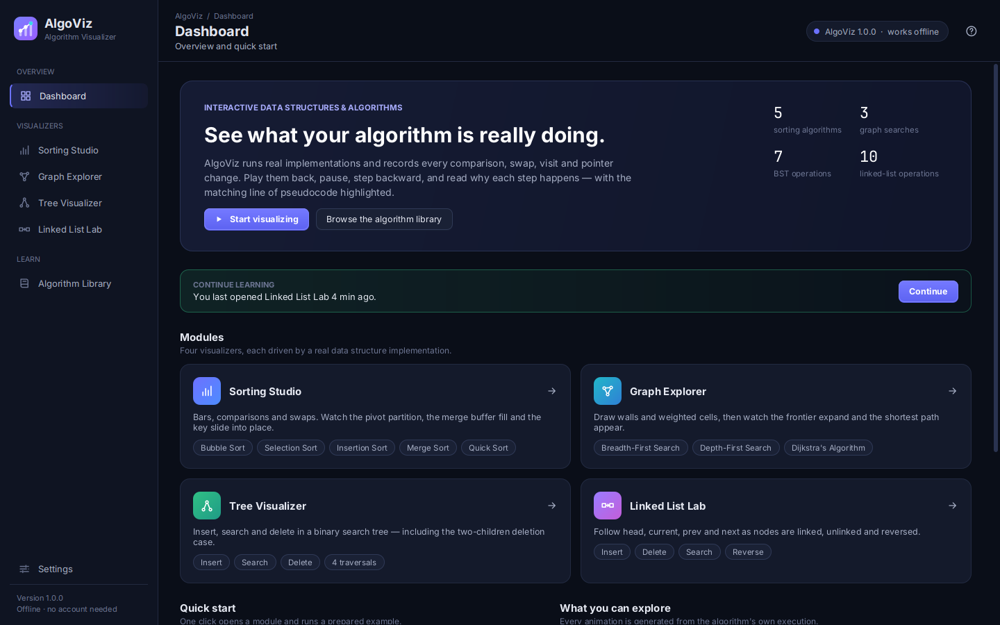
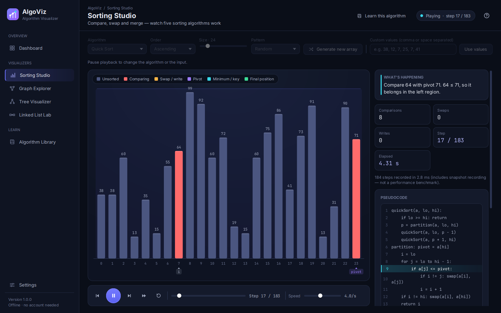
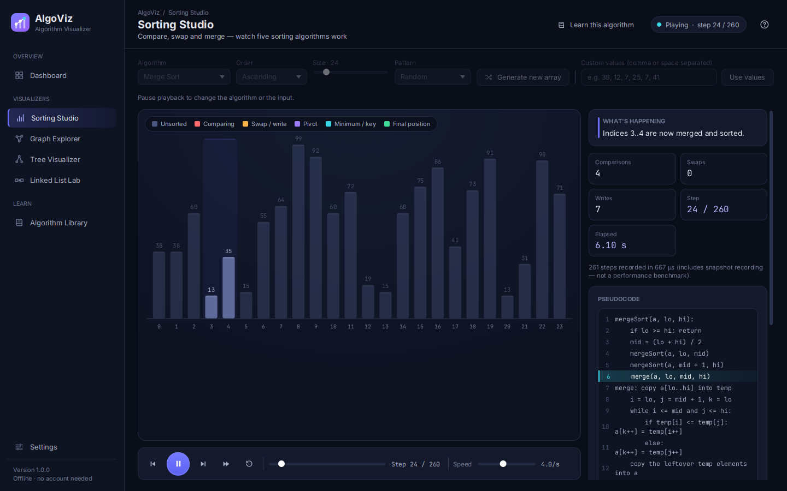
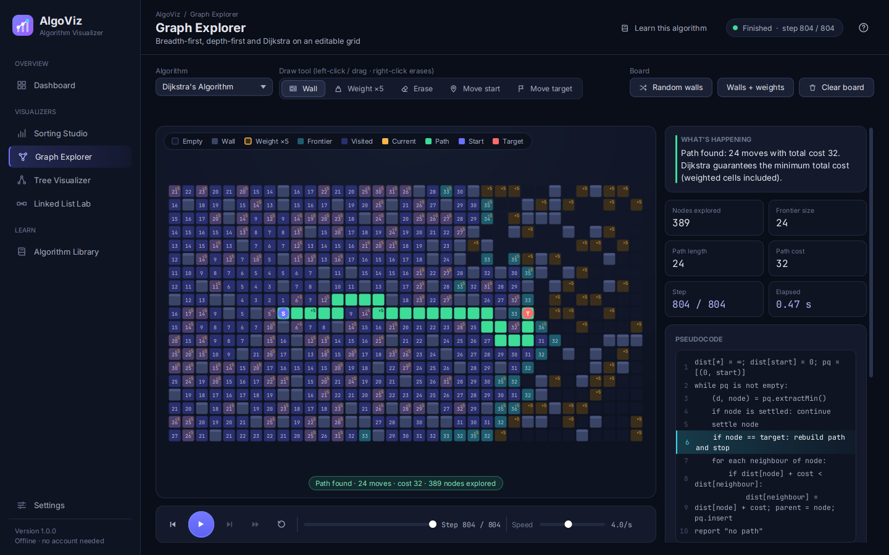
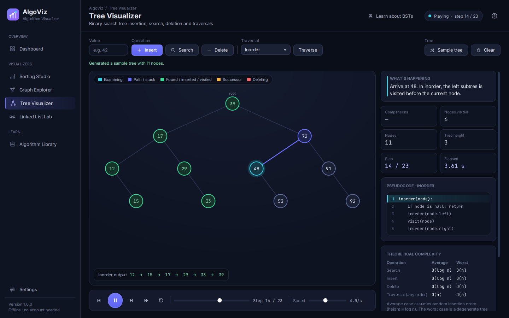
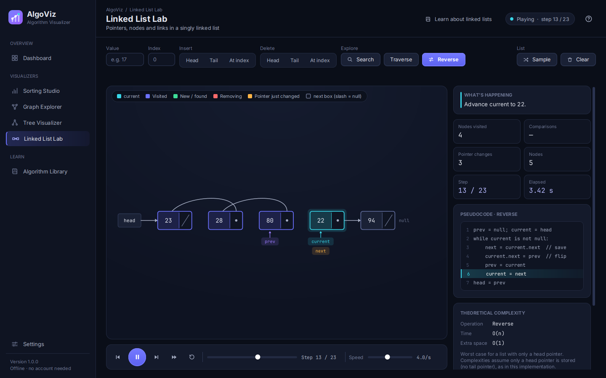
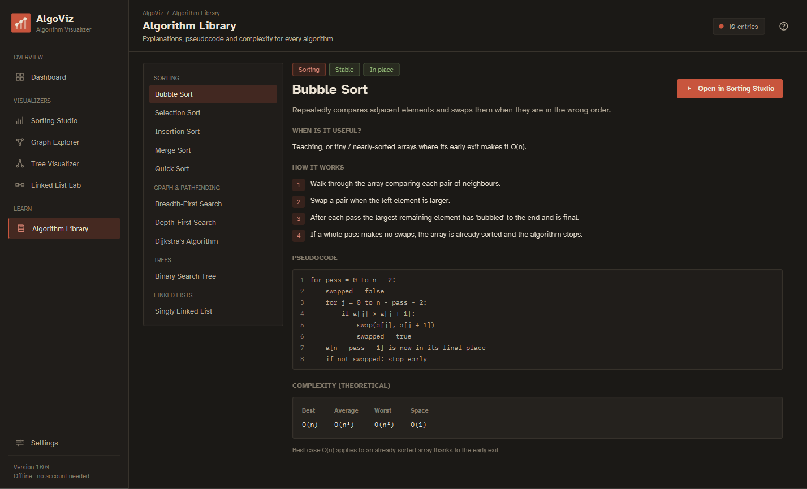
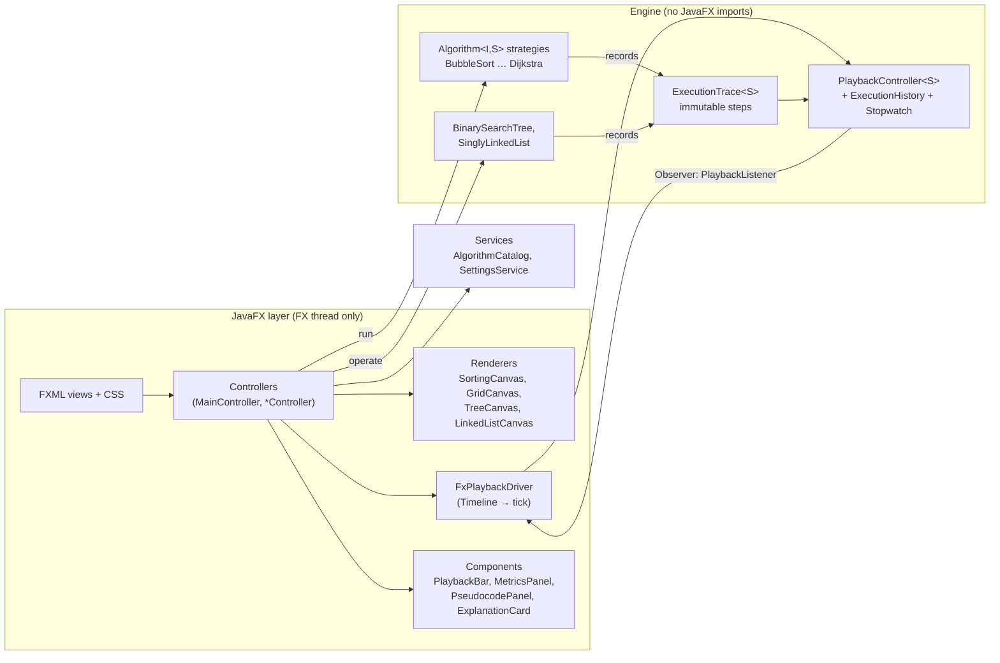

# AlgoViz — Interactive Data Structures & Algorithms Visualizer

AlgoViz is a JavaFX desktop application that shows how data structures and algorithms execute internally.
Every animation is generated from a **real, instrumented implementation**: the engine records each comparison,
swap, visit and pointer change as an immutable snapshot, and the UI plays those snapshots back — forward,
backward, paused or at any speed — together with the matching pseudocode line and a plain-English explanation.



---

## 1. Problem statement

Students often memorise sorting, graph traversal, linked lists and trees without seeing what actually happens
during execution. Static diagrams cannot show *order of operations*, and most online animations are hard-coded
sequences that are not connected to real code.

## 2. Objectives

* Visualize real algorithm execution, not scripted animations.
* Connect three things at every step: the data, the pseudocode line, and an explanation of *why*.
* Support genuine Step Backward (restore the exact previous state, counters included).
* Report only honest metrics (counted by the engine) and clearly label theory as theory.
* Demonstrate clean Java OOP, design patterns, testing and a maintainable architecture.

## 3. Features

| Module | What it does |
|---|---|
| **Dashboard** | Welcome, entry points to every module, honest summary, *Continue learning* (only if you really opened a module before). |
| **Sorting Studio** | Bubble, Selection, Insertion, Merge, Quick Sort. Ascending/descending. Size 2–150, patterns (random, nearly sorted, reversed, sorted, few unique), custom input with validation. Merge Sort shows its temporary buffer; Insertion Sort lifts the key out and shows shifts; Quick Sort shows pivot and `i` boundary; Selection Sort shows the current minimum. |
| **Graph Explorer** | 19 × 35 grid, 4-directional movement. Draw/erase walls and weighted cells (cost 5), move start/target. BFS, DFS, Dijkstra. Frontier, visited, current node, final path, Dijkstra distances, explicit *No path found* state. |
| **Tree Visualizer** | Standard (unbalanced) BST: insert, search, delete (leaf / one child / two children with inorder successor), inorder, preorder, postorder, level-order, sample tree, clear. Duplicates rejected. |
| **Linked List Lab** | Singly linked list (head pointer only): insert head/tail/index, delete head/tail/index, search, traverse, reverse, clear. Every pointer assignment is its own step; arrows are drawn from the real `next` pointers so reversal visibly flips them. |
| **Algorithm Library** | Summary, use cases, how it works, pseudocode, best/average/worst complexity, stability, in-place status, operation tables, "Open in visualizer". |
| **Settings** | Default speed, animate transitions (reduced motion), default array size, start module, Dijkstra distances, clear recent activity, reset. Saved to `~/.algoviz/settings.properties`. |

Shared execution controls in every visualizer: **Previous step and Next step**. There is no automatic playback; the
user advances every step by hand. Keyboard: `←`, `→`, `Ctrl+1…7`, `F1`.

| | |
|---|---|
|  |  |
|  |  |
|  |  |

*Screenshots were captured from the running application (Xvfb, 1440×900) with the screenshot harness in
`src/test/java/com/algoviz/tools/ScreenshotHarness.java`.*

## 4. Technology stack

* Java 17+ (built and tested on OpenJDK 21), JavaFX 21.0.5 (controls, FXML), custom CSS
* Maven 3.9, JUnit 5
* Bundled fonts: Atkinson Hyperlegible and IBM Plex Mono (SIL Open Font License, see `src/main/resources/com/algoviz/fonts/`)
* No database, no network access, no accounts

## 5. Architecture overview



**Flow of one run:** the controller builds the input → the selected `Algorithm` strategy runs on it (in a
background `Task` for sorting/graph) and returns an `ExecutionTrace` of immutable steps → the trace is loaded into
the `PlaybackController` → a JavaFX `Timeline` calls `tick()` → listeners render the current step, update
pseudocode, explanation and metrics.

## 6. Package structure

```
src/main/java/com/algoviz/
├── AlgoVizApplication.java, Launcher.java   entry points
├── config/AppConfig                         limits and constants
├── model/                                   AlgorithmMetadata, ExecutionMetrics, MetricType, ModuleId, UserSettings …
├── engine/                                  Algorithm, ExecutionStep, ExecutionTrace, ExecutionHistory,
│   │                                        PlaybackController, PlaybackState, PlaybackListener, Stopwatch
│   ├── sorting/                             SortingAlgorithm (template), 5 algorithms, SortRecorder, SortStep …
│   ├── graph/                               Graph, GridGraph, AdjacencyListGraph, GraphSearchAlgorithm, BFS, DFS, Dijkstra …
│   ├── tree/                                BinarySearchTree, TreeNode, TreeSnapshot, TreeStep, TreeOperation …
│   └── linkedlist/                          SinglyLinkedList, ListNode, ListSnapshot, ListStep, ListOperation …
├── service/                                 AlgorithmCatalog (strategy registry + docs), SettingsService (persistence)
├── controller/                              MainController, VisualizerController (base), StaticPageController (base),
│                                            Dashboard/Sorting/Graph/Tree/LinkedList/Library/Settings controllers, AppContext
├── ui/animation/                            FxPlaybackDriver, Tween, BackgroundRunner
├── ui/component/                            PlaybackBar, MetricsPanel, PseudocodePanel, ExplanationCard, ComplexityCard,
│                                            Legend, EmptyState, NotificationCenter, Icons, IconType, BrandMark
├── ui/render/                               ResizableCanvas (base) + 4 canvases
├── ui/theme/                                Palette, FontLoader
└── util/                                    ValidationUtils, InvalidInputException, ComplexityUtils
src/main/resources/com/algoviz/  fxml/ (8 views) · css/ (app, components, modules) · fonts/
src/test/java/com/algoviz/       engine/ · service/ · util/ · ui/UiSmokeTest · tools/ScreenshotHarness
```

## 7. Class responsibilities (key classes)

| Class | Responsibility |
|---|---|
| `ExecutionStep` | Interface of one immutable snapshot: explanation, pseudocode line, metrics, status. |
| `ExecutionTrace<S>` | Ordered, unmodifiable list of steps from one run (+ recording time). |
| `ExecutionHistory<S>` | Cursor over a trace: forward, backward, seek, rewind. |
| `PlaybackController<S>` | FX-independent state machine (EMPTY/READY/PLAYING/PAUSED/FINISHED), stopwatch, generation counter, observers. |
| `FxPlaybackDriver<S>` | Adapts the controller to JavaFX: `Timeline` ticks, observable properties, speed. |
| `SortRecorder` | Instrumented array — every compare/swap/write goes through it, so counts and highlights are always consistent. |
| `SortingAlgorithm` | Template method: records initial/final states; subclasses implement `sort()`. |
| `GraphSearchAlgorithm` | Template: initial state, path reconstruction from parent pointers, "no path" outcome. |
| `GridGraph` / `AdjacencyListGraph` | Two `Graph` implementations (editable grid; general weighted graph, rejects negative weights). |
| `BinarySearchTree` | Real BST; traced operations mutate the tree and return the recorded steps. |
| `SinglyLinkedList` | Real singly linked list; each pointer assignment is recorded. |
| `VisualizerController<S>` | Base controller wiring playback bar, explanation, pseudocode and metrics for all four visualizers. |
| `MainController` | Shell, navigation, lazy FXML loading, header status, keyboard shortcuts, help dialog. |
| `AlgorithmCatalog` | Registry of strategies and documentation used by controllers and the library. |
| `SettingsService` | Loads/saves preferences atomically; tolerates missing/malformed files. |

## 8. OOP concepts demonstrated

* **Encapsulation** — steps copy their arrays in and out (`SortStep.values()` returns a clone); `TreeNode`/`ListNode` are package-private so only their data structure can change them; settings validate in setters.
* **Abstraction** — `Algorithm<I,S>`, `ExecutionStep`, `Graph`, `ModuleController` describe *what*, not *how*.
* **Inheritance (genuine is-a)** — `BubbleSort … QuickSort extends SortingAlgorithm`; `BreadthFirstSearch/DepthFirstSearch/Dijkstra extends GraphSearchAlgorithm`; four canvases `extends ResizableCanvas`; four visualizer controllers `extends VisualizerController<S>`.
* **Polymorphism** — controllers call `algorithm.run(input)` on whichever strategy is selected; the playback system works with any `ExecutionStep` subtype.
* **Composition** — controllers are composed of `PlaybackBar`, `MetricsPanel`, `PseudocodePanel` …; `PlaybackController` *has an* `ExecutionHistory` and a `Stopwatch`.
* **Generics** — `ExecutionTrace<S extends ExecutionStep>`, `PlaybackController<S>`, `FxPlaybackDriver<S>`, `VisualizerController<S>`, `BackgroundRunner.submit<T>`.
* **Enums** — `SortEventType`, `PlaybackState`, `MetricType` (with definitions), `NodeVisual`, `TreeOperation`/`ListOperation` (with pseudocode), `ModuleId`.
* **Records** — `GridCell`, `SortMarker`, `ComplexityEntry`, `AlgorithmMetadata`, `ListSnapshot`, `TreeSnapshot.Node`.
* **Exception handling** — checked `InvalidInputException` for user input (shown inline); `IllegalArgumentException` for programming errors (e.g. negative edge weights); settings I/O failures are logged and reported, never crash; an uncaught-exception handler on the FX thread shows a dialog.
* **Collections** — `ArrayDeque` (BFS queue, DFS stack, level-order), `PriorityQueue` (Dijkstra), `EnumMap` (metrics), `TreeSet`/`HashMap`/`LinkedHashMap`, `CopyOnWriteArrayList` (listeners).

## 9. Design patterns

| Pattern | Where | Why |
|---|---|---|
| **Strategy** | `Algorithm<I,S>`; `SortingAlgorithm` and `GraphSearchAlgorithm` subclasses; selected via `AlgorithmCatalog` | Interchangeable algorithms behind one interface; the controller code is identical for all five sorts. |
| **Template Method** | `SortingAlgorithm.run()` → `sort()`; `GraphSearchAlgorithm.run()` → `search()` | Shared recording of initial/final state, path reconstruction and timing lives in one place. |
| **Observer** | `PlaybackListener` on `PlaybackController`; `StepChangeListener` on `FxPlaybackDriver`; JavaFX property listeners | Engine notifies the UI without depending on JavaFX. |
| **MVC** | FXML views (View), controllers (Controller), engine/model packages (Model) | Algorithms never touch UI classes; FXML holds no logic. |
| **Memento-style snapshots** | `SortStep`, `GraphStep`, `TreeSnapshot`, `ListSnapshot` | Immutable captured states make Step Backward exact. |
| **Dependency injection (manual)** | `AppContext` passed through the FXML controller factory | Shared services without global singletons. |

**Singleton is deliberately not used**: there is no state that must be globally unique; `AppContext` is created once
by the application and passed explicitly, which keeps classes testable.

## 10. Algorithms and complexity

### Sorting

| Algorithm | Best | Average | Worst | Space | Stable | In place |
|---|---|---|---|---|---|---|
| Bubble Sort (early exit) | O(n) | O(n²) | O(n²) | O(1) | Yes | Yes |
| Selection Sort | O(n²) | O(n²) | O(n²) | O(1) | No | Yes |
| Insertion Sort | O(n) | O(n²) | O(n²) | O(1) | Yes | Yes |
| Merge Sort (top-down) | O(n log n) | O(n log n) | O(n log n) | O(n) | Yes | No |
| Quick Sort (Lomuto, last pivot) | O(n log n) | O(n log n) | O(n²) | O(log n) avg, O(n) worst | No | Yes |

Counter definitions (tooltips in the app): **Comparisons** = element-vs-element value comparisons; **Swaps** =
exchanges of two positions; **Writes** = individual array assignments (a swap counts as two; Insertion Sort shifts
and Merge Sort copies are writes, never swaps).

### Graph (V = cells, E = edges; on a 4-directional grid E ≤ 4V)

| Algorithm | Time | Space | Shortest path? |
|---|---|---|---|
| BFS | O(V + E) | O(V) | Fewest moves (ignores weights) |
| DFS (iterative) | O(V + E) | O(V + E) stack entries | No |
| Dijkstra (binary heap, lazy deletion) | O((V + E) log V) | O(V + E) | Minimum cost, requires weights ≥ 0 |

On a grid without weighted cells every move costs 1, so BFS and Dijkstra find equally short paths.

### Binary Search Tree (h = height)

| Operation | Average | Worst |
|---|---|---|
| Search / Insert / Delete | O(log n) | O(n) |
| Any traversal | O(n) | O(n) |

Average assumes random insertion order; inserting sorted data produces a degenerate tree of height n − 1. The BST
does **not** self-balance (no AVL in this release).

### Singly linked list (head pointer only)

| Operation | Time |
|---|---|
| Insert/delete at head, clear | O(1) |
| Insert/delete at tail or index, search, traverse, reverse | O(n) |

## 11. Installation

Requirements: **JDK 17 or newer** and **Maven 3.8+**. JavaFX is downloaded by Maven automatically (it is not part
of the JDK); the correct native artifacts for Windows, macOS or Linux are selected by the OpenJFX dependencies.

```bash
git clone <repository-url>
cd AlgViz-
mvn -q compile
```

## 12. Running

**Easiest:** install a JDK 17+ (e.g. from https://adoptium.net), then double-click `run-windows.bat`
(Windows) or run `./run-mac-linux.sh` (macOS/Linux). Maven is not needed: the bundled Maven Wrapper downloads it.

```bash
mvn javafx:run                       # recommended
# or build a self-contained jar for the current platform:
mvn package
java -jar target/algoviz-1.0.0-app.jar
```

The `-app.jar` contains the JavaFX natives of the platform it was built on (build it on the machine you run it on).
JavaFX prints a harmless "Unsupported JavaFX configuration: classes were loaded from unnamed module" warning
when started from the jar.

## 13. Tests

```bash
mvn test                             # engine, service, util tests (UI test skipped without a display)
xvfb-run -a mvn test                 # Linux headless: also runs the JavaFX UI smoke test
```

Latest run (OpenJDK 21, Linux, under Xvfb): **1086 tests, 0 failures, 0 errors, 0 skipped.**

| Suite | Tests | What is verified |
|---|---|---|
| `SortingAlgorithmTest` | 1005 | Each of the 5 sorts × 50 inputs (empty, single, sorted, reversed, duplicates, negatives, 40 random up to 150 elements) × both orders vs `Arrays.sort`; counters never decrease and match event types; **no element is ever marked "sorted" before it holds its final value**; swap-based sorts always hold a permutation; input array is not modified. |
| `SortingCountersTest` | 8 | Hand-computed counts (Bubble early exit, Selection swaps, Insertion shifts = writes, Merge writes per level, Quick Sort worst case), buffer and held key shown. |
| `GraphSearchTest` | 25 | Valid path, no path, start = target, blocked corridor, corners/boundaries, BFS layer order, DFS goes deep, BFS optimal on 60 random grids vs reference, Dijkstra optimal cost on 60 weighted grids vs reference O(V²) Dijkstra, cheaper-but-longer route, zero weights, negative weights rejected, frontier metric consistency. |
| `BinarySearchTreeTest` | 13 | Insert/search, duplicates, all three deletion cases incl. root, all four traversals, empty tree, height/degenerate tree, 2000 random ops vs `TreeSet` with BST property checked after each, stable node ids. |
| `SinglyLinkedListTest` | 10 | All insert/delete positions, empty and single-node lists, invalid indices leave list unchanged, search counts, traverse, reverse (pointer changes, arrows flip mid-operation), safe link order on insert, clear. |
| `PlaybackControllerTest` | 15 | Pause stops ticks, resume, finish, replay, step forward/back restore identical snapshots and metrics, repeated round trips, reset clears time, paused time excluded (fake clock), generation invalidation, seek, listeners. |
| `SettingsServiceTest` | 4 | Defaults, round trip, malformed values, unreadable/unwritable file. |
| `AlgorithmCatalogTest`, `ValidationUtilsTest` | 5 | Catalog completeness and stability facts; input parsing and range errors. |
| `UiSmokeTest` | 1 | Launches the real app, opens every module, drives Previous/Next stepping via the UI, validates inline errors, runs tree/list/graph operations, fails on any FX-thread exception. |

## 14. Limitations and future work

* BST does not self-balance (AVL/Red-Black would be a separate feature).
* Graph Explorer uses a fixed 19 × 35 grid with one weight value (5); no diagonal movement; no A*.
* Linked List Lab is limited to 10 nodes and the tree to 63 nodes so every node stays readable.
* Single dark theme; no sound.
* The shaded jar is platform-specific; jlink/jpackage installers are not provided yet.
* The elapsed time is animation wall-clock time, not an algorithm benchmark (by design).

See `docs/VIVA.md` for viva preparation notes.
